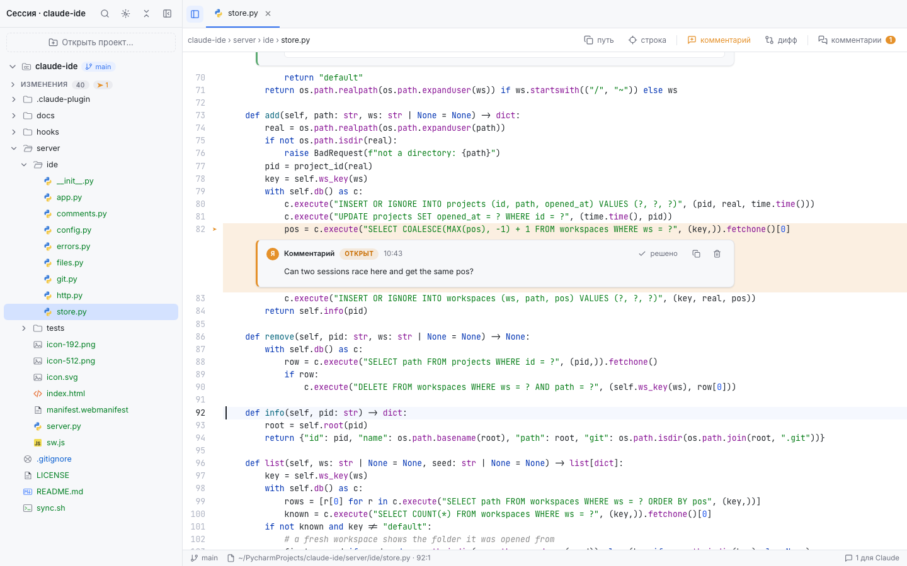
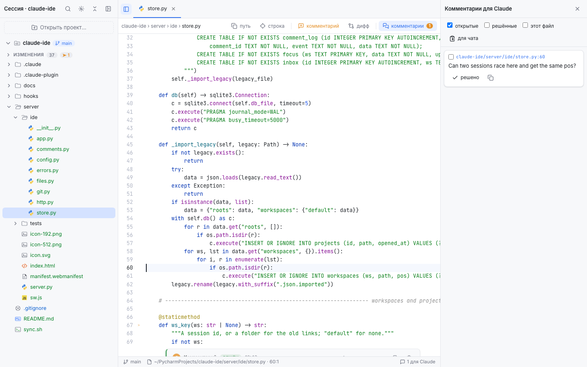
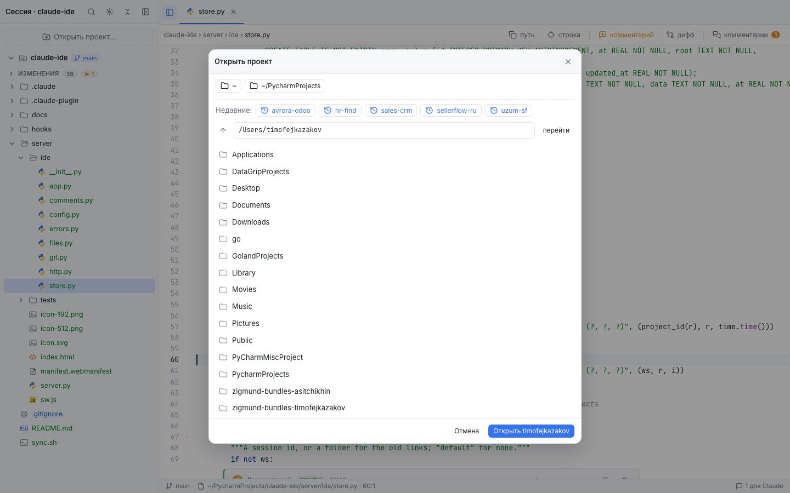
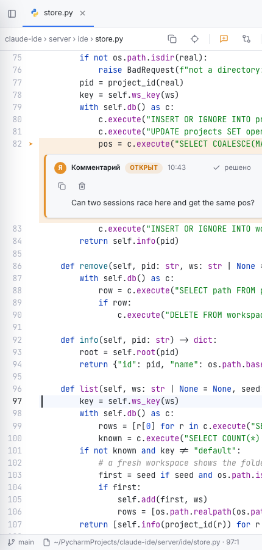

<h1 align="center">claude-ide</h1>

<p align="center">
  A side editor for <a href="https://code.claude.com">Claude Code</a>: browse projects, edit code, leave line comments, and let Claude read and resolve them.
</p>

<p align="center">
  
  
  
  
</p>

<p align="center">
  
</p>

claude-ide is two small pieces that work together:

- **A web editor** served by a local, dependency-free Python server. A PyCharm-style file tree for several projects at once, a CodeMirror editor with autosave, git status and diffs, branch switching, a fuzzy file finder, and **line comments addressed to Claude**.
- **A Claude Code mod** (a plugin with function hooks) that attaches your open comments and whatever you are looking at in the editor to every prompt, gives Claude tools to resolve comments with a reply, and adds a band above the prompt with the number of comments waiting.

Everything stays on your machine: the server listens on `127.0.0.1` only, comments live in each project's `.claude/review.json`, and the mod talks to nothing but `localhost`.

## How it feels

1. Run `/ide` in a Claude Code session. The mod starts the server, registers the session's folder, and prints a link.
2. Open the link in the Browser pane of the Claude desktop app, or install it as a PWA.
3. Hover a line of code, click the comment icon, type what you want changed. Enter.
4. Send any message in the chat. Claude sees the comment with its file and lines, edits the code, and marks the comment resolved with a short reply that appears under the arrow in the editor.
5. Say "fix this" without a path: the file and the lines you selected travel with the prompt.

## Features

**Projects and files**
- Several projects per session; the list and the editor state (open tabs, expanded folders, sidebar width) are kept per Claude Code session and come back when you resume it.
- Project picker with a folder browser, recent projects, and `git`/`project` badges.
- Tree with file-type icons, `.gitignore` and noise folders hidden, git status colors, a collapsible "Changes" list.
- Fuzzy file finder (`⌘P`, `name:line` jumps to a line), `⌘B` hides the sidebar, `⌘O` opens a project.

**Editing**
- CodeMirror 5 with syntax colors for Python, TypeScript, JavaScript, HTML, CSS, YAML, TOML, JSON, Markdown, SQL, shell and Dockerfiles.
- Autosave 0.7 s after the last keystroke and on blur; a banner when Claude changed the file on disk while you were typing.
- Files reload when they change on disk, so Claude's edits show up without a refresh.
- Diff view against `HEAD`, Markdown preview, branch chip with `↑`/`↓` and one-click `git checkout`.

**Comments for Claude**
- Comment icon in the gutter on hover, a toolbar button, `⌘⇧M`; ranges via selection or Shift+click.
- Each comment stores its file, lines, the text of those lines (to find them again when the code moves), your text, status, and Claude's reply.
- Comments drawer with filters and "copy for chat"; diff lines can be commented too.

**Claude Code integration**
- `prompt.submit` hook: open comments and the editor focus are attached as context to every prompt.
- Tools `review_list` and `review_resolve` for Claude; resolving writes the reply back into the editor.
- A band above the prompt: "IDE · 2 comments for Claude" with *link*, *sort out* and *hide*. A toast and a status-line entry when a new comment arrives.
- An "open in IDE" button under Claude's `Edit`, `Write` and `Read` rows in the transcript.

<p align="center">
  
</p>

## Install

The repository is its own plugin marketplace. From a terminal:

```bash
claude plugin marketplace add Axel791/claude-ide
```

```bash
claude plugin install claude-ide@claude-ide
```

Then in any Claude Code session, including the Code tab of the desktop app:

```text
/ide
```

`/ide <path>` adds another project to the session, `/ide open` also tries to show the page in the Browser pane.

Requirements: Claude Code 2.1.287 or newer (mods), Python 3.9+ on the machine (the server uses only the standard library), git for status and diffs.

## Screenshots

<table>
  <tr>
    <td align="center"><br><sub>Project picker</sub></td>
    <td align="center"><br><sub>Narrow layout</sub></td>
  </tr>
</table>

## How it works

```
Claude Code session ──/ide──▶ mod (hooks/register.ts)
        │                          │  starts server, registers project, prints link
        │                          ▼
        │                  server/server.py  127.0.0.1:8030  (SQLite + review.json)
        │                          ▲
        │                          │  HTTP
        │                   server/index.html  (the editor, a PWA)
        │
        ├── prompt.submit: open comments + editor focus → context for Claude
        ├── review_resolve: Claude's reply → review.json → under the arrow in the editor
        └── AbovePrompt band, "open in IDE" on tool rows
```

The server keeps projects, per-session workspaces, UI state and a comment log in SQLite at `~/.claude/claude-ide/ide.db`. Comments themselves stay in `<project>/.claude/review.json` (added to the project's `.gitignore` automatically), so Claude can read them even when the server is down.

## Repository layout

```
.claude-plugin/   plugin manifest and marketplace file
hooks/            the mod
  register.ts     the only file that touches the engine's `$`: adapters and event wiring
  config.ts       port, timings, texts
  core/           pure logic with injected dependencies, unit-tested without the engine
server/
  server.py       entry point
  ide/            config, SQLite store, files, git, comments, HTTP router, app wiring
  index.html      the editor page; manifest, service worker and icons beside it
  tests/          unittest suite for the server
docs/             screenshots
```

## Development

The mod is read straight from this folder when installed from the local marketplace: edit, then `/reload-plugins` in the session. The page needs only a refresh; restart the server with `pkill -f server.py` and the mod will start it again.

```bash
claude plugin validate . && claude plugin test .
```

```bash
python3 -m unittest discover -s server/tests
```

## Privacy and policy

The mod uses only documented Claude Code extension points: a slash command, the `prompt.submit` context, plugin tools, the band above the prompt, and tool-row rendering. It does not touch permissions, reads no tokens or keys, and sends nothing anywhere but `127.0.0.1`. The only message it ever submits on your behalf is the *sort out* button, and only when you press it.

## License

MIT
